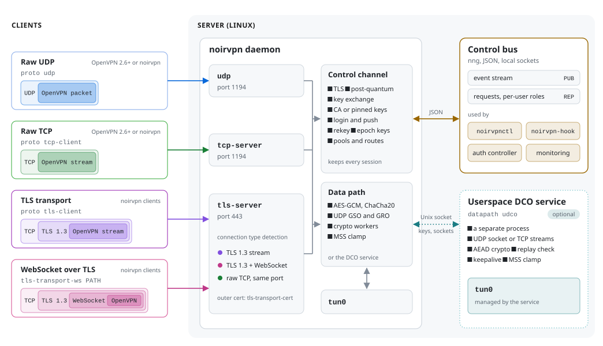

<p align="center">
  
</p>

noirvpn implements the OpenVPN layer-3 tunnel protocol as a
client for Linux, Windows and macOS, and as a server for Linux.
It connects to OpenVPN 2.6 and 2.7 servers, accepts OpenVPN 2.6 and 2.7 clients
and reads OpenVPN configuration files. It is an independent implementation,
written from scratch in [Odin](https://odin-lang.org) and
licensed under Apache-2.0.

<div align="center">
  <video src="https://github.com/user-attachments/assets/5f1f744e-5f10-4f3a-b96d-8dd30460d043" controls></video>
  <p><em>noir client on Windows connecting to OpenVPN server and noir server</em></p>
</div>

## Architecture

<p align="center">
  
</p>

## What's here

The programs:

| Program | Systems | Use |
|---------|---------|-----|
| `noirvpn` | Linux, macOS, Windows | The VPN daemon: client and server (server on Linux only). |
| `noirvpnctl` | Linux, macOS, Windows | CLI to control a running daemon from the shell: status, peers, profiles, connect and disconnect. |
| `noirvpn-hook` | Linux | Run commands on daemon events; does not need root. |
| `noirvpn-desktop` | Linux, macOS, Windows | The graphical desktop app, using SDL3 rendering. It has a profile manager and interacts with `noirvpn` client. |

## Performance

The table below are from testing peers of the same type with TCP single stream
using iperf3. Other than WireGuard which uses ChaCha20-Poly1305, the data cipher
is AES-256-GCM. Values are in Gbit/s.

| Implementation | UDP TX | UDP RX | TCP TX | TCP RX |
|---|---:|---:|---:|---:|
| OpenVPN 2.7.7, userspace | 0.72 | 1.22 | 0.84 | 1.15 |
| OpenVPN 2.7.7, kernel DCO | 4.23 | 4.18 | 4.31 | 4.58 |
| noirvpn, userspace | 8.34 | 6.98 | 4.91 | 5.17 |
| noirvpn, userspace, `workers 2` | 12.19 | 9.42 | 6.01 | 6.66 |
| WireGuard, kernel | 7.09 | 5.42 | n/a | n/a |

Note:
- `workers` is number of threads noirvpn uses for crypto, none if not specified.
  See [`workers`](docs/options.md).
- WireGuard has no TCP transport.

Test setup (2026-11-20):

- Two VMware ESXi virtual machines with 4 vCPUs of an AMD Ryzen 9 5900X and 3.9 GiB of
  memory each, Alpine Linux (musl), Linux 6.18, OpenSSL 3.5.
- Networking: ConnectX-5 virtual functions between them, 30 Gbit/s raw.
- tls-crypt on OpenVPN and noirvpn tunnels.
- Tunnel MTU is 1400 for noirvpn, 1428 for OpenVPN and 1420 for WireGuard.

## What is different

**Smaller surface.** Noir keeps the parts of OpenVPN that current
deployments use. It removes compression, static-key mode, tap and bridging, and
peers older than OpenVPN 2.6. Run `noirvpn --check-config` to see what happens
to each line of your configuration before you start the daemon. The
[option reference](docs/options.md) lists every option it supports.

**An nng control bus instead of scripts and plugins.** The bus replaces scripts,
plugins and the management interface. It has a stream of JSON events and a
request channel with per-user roles. Ref: [nng](https://nng.nanomsg.org)

The bus capabilities:

- Monitoring tools subscribe to the events.
- Your own controller implementation can decide how and what to do with
  each client login (`auth-external`).
- `noirvpnctl` shell command to control a daemon. A user with the
  authorised role can load a profile into the `client-service` and
  connect through `noirvpnctl` (see [Service mode](docs/client.md#service-mode)).
- `noirvpn-hook` can be used to run commands on events without root.

**TLS transport.** `proto tls-client` and `proto tls-server` send the
OpenVPN TCP stream inside TLS 1.3, so the tunnel looks like HTTPS.

- Only requires one port to serve both the TLS transport and plain OpenVPN TCP clients.
- HTTP proxy support in the client (CONNECT, Basic authentication).
- WebSocket framing support in the server, with reverse proxies that forward them using HTTP.
- The client can detect if someone terminated the encapsulating TLS transport on the way, but
  does not break the trust with the actual server.

**Pinned keys instead of a CA.** A server can accept clients by the key they
present by storing the keys in a (`peer-keys`) file, with or without
a certificate authority.

**Post-quantum key exchange by default.** hybrid X25519MLKEM768 preferred.

**A fast data path.** The data channel is tuned for high-throughput and
uses only AEAD ciphers (AES-GCM and ChaCha20-Poly1305) and the epoch data
keys of OpenVPN 2.7, supporting both UDP and TCP connections.

**Kernel data channel offload.** With `datapath dco`, noirvpn passes the data
channel to the `ovpn` module of the Linux kernel (Linux 6.16 or later). With the
fast data path in userspace, DCO is only necessary if you experience other
bottleneck.

**An open data channel offload interface.** With `datapath udco`, noirvpn
can use a custom userspace DCO service over the local unix socket.

## Building

See [build/README.md](build/README.md) for build instructions.

## Quick start

A client with a CA, a certificate and a tls-crypt key:

```
client
dev tun
proto udp
remote vpn.example.com 1194
ca ca.crt
cert client.crt
key client.key
tls-crypt tc.key
```

A server for that client:

```
dev tun
proto udp
port 1194
server 10.8.0.0 255.255.255.0
topology subnet
ca ca.crt
cert server.crt
key server.key
tls-crypt tc.key
keepalive 10 60
```

Check the configuration. Then start the daemon as root or with `CAP_NET_ADMIN`:

```sh
noirvpn --check-config --config client.conf
noirvpn --config client.conf
```

For the tls transport, set `proto tls-client` and a remote on port 443 on the
client. On the server, set `proto tls-server` and `port 443`.

Control a running daemon:

```sh
noirvpnctl status
noirvpnctl peers          # on a server
```

## noirconf server Web-UI

A server management interface is implemented in [noirconf](noirconf), which allows you
to configure multiple instances of noirvpn server and generate per-user client configuration.
It is a Python based application that is launched on the same host as the noirvpn server. Only
python 3.9 (or newer) and openssl are required.

## Migrating an OpenVPN server to noirvpn

noirvpn can read the server and client configuration without change most of the time.
Follow the steps below to ensure that they are compatible.

1. Check the configuration you have:
   `noirvpn --check-config --config server.conf`. Each line shows as
   supported, ignored (a warning) or rejected (the server does not start),
   with the replacement.
2. Replace the rejected options:

   | OpenVPN | noirvpn |
   |---------|---------|
   | `client-connect`, `client-disconnect`, `learn-address`, `up`, `down` and other scripts | Events on the control bus, or `noirvpn-hook` |
   | `auth-user-pass-verify`, `tls-verify`, `plugin` | `peer-passwords`, `peer-keys` or `auth-external` |
   | `management`, `status` | `noirvpnctl status`, `noirvpnctl peers`, `stats-interval` |
   | `client-cert-not-required`, `verify-client-cert none` | `verify-client-cert optional` with `peer-passwords` or `auth-external` |
   | `compress`, `comp-lzo` | Remove: there is no compression |
   | `dev tap`, `server-bridge` | `dev tun`: layer 3 only |
   | `topology net30`, `topology p2p` | `topology subnet` |
   | `pkcs12`, `pkcs11-*` | PEM files |

3. Start the daemon as root or with `CAP_NET_ADMIN`:
   `noirvpn --config server.conf`. Watch it with `noirvpnctl status` and
   `noirvpnctl peers`.
4. Add the noirvpn options you want (all optional):

| Option | Values | Default | Use and example |
|--------|--------|---------|-----------------|
| `peer-keys` | file path | - | Peers file: one pinned client key per line. Clients need no CA.<br>`peer-keys /etc/noirvpn/peers`<br>A line: `alice  sha256:EEdckfvr1RFz...=  ifconfig-push=10.8.0.10` |
| `peer-keys-mode` | `pin`, `both`, `either` | `pin` | `both`: a CA chain and a pin. `either`: a pin, else a CA chain. Both need `ca` and `peer-keys`.<br>`peer-keys-mode either` |
| `peer-passwords` | file path | - | User names and password hashes; the server checks client passwords itself.<br>`peer-passwords /etc/noirvpn/users`<br>A line: `alice<TAB>pbkdf2-sha256:260000:<salt>:<hash>` |
| `auth-external` | seconds (optional) | off | A controller on the control bus decides each login, within the timeout.<br>`auth-external 30` |
| `auth-web` | none | off | Web sign-in through the controller. Needs `auth-external` and `verify-client-cert optional`.<br>`auth-web` |
| `pq-mode` | `off`, `prefer`, `require` | `prefer` | Hybrid post-quantum key exchange (X25519MLKEM768).<br>`pq-mode require` |
| `datapath` | `userspace`, `dco`, `udco`, `auto` | `userspace` | Who moves the packets: this process, the Linux `ovpn` kernel module (6.16 or later), a userspace DCO service, or the best one available.<br>`datapath auto` |
| `dco-socket` | socket path | `/run/udco/udco.sock` | Socket of the DCO service, for `datapath udco` or `auto`.<br>`dco-socket /run/udco/udco.sock` |
| `workers` | number of threads | `0` (none) | Crypto worker threads; clients are spread over them.<br>`workers 4` |
| `connect-freq-source` | number | `20` | Initial replies for one source address in the `connect-freq-initial` window (`0`: no limit).<br>`connect-freq-source 20` |
| `stats-interval` | seconds | off | Send a `stats.tick` event on the bus every n seconds.<br>`stats-interval 10` |
| `bus-control` | `off`, or path `[mode M] [group G]` | `/run/noirvpn/<config name>.control` | The control socket for `noirvpnctl` and controllers.<br>`bus-control /run/noirvpn/server.control mode 0660 group noirvpn` |
| `bus-events` | `off`, or path `[mode M] [group G]` | `/run/noirvpn/<config name>.events` | The events socket for monitors and `noirvpn-hook`.<br>`bus-events /run/noirvpn/server.events mode 0640 group noirvpn` |
| `bus-allow` | `uid`, `gid` or `sid`, an id, roles | - | Who may use the control socket, and with which roles. One line per rule.<br>`bus-allow uid 0 admin`<br>`bus-allow gid noirvpn read` |
| `proto tls-server` | value of `proto` | - | The tls transport: OpenVPN TCP inside TLS 1.3, for noirvpn clients.<br>`proto tls-server` with `port 443` |
| `tls-transport-accept-tcp` | none | off | A `tls-server` port also accepts plain OpenVPN TCP clients.<br>`tls-transport-accept-tcp` |
| `tls-transport-cert`, `tls-transport-key` | file path | `cert`, `key` | Certificate (leaf first, then the chain) and key of the outer TLS.<br>`tls-transport-cert /etc/noirvpn/tls.crt`<br>`tls-transport-key /etc/noirvpn/tls.key` |
| `tls-transport-ws` | URL path | off | Serve the tls transport over WebSocket at this path, for a reverse proxy.<br>`tls-transport-ws /vpn` |
| `tls-transport-dev` | device name | dev name + `-tls` | Second tun device for tls clients under `datapath dco` or `udco`.<br>`tls-transport-dev tun0-tls` |

[Server](docs/server.md#differences-from-openvpn-servers) lists every
difference, and the [option reference](docs/options.md) gives the status of
each OpenVPN option.

## Source layout

| Directory | Content |
|--------|---------|
| `cmd/` | The command-line programs. |
| `desktop/` | The desktop app. |
| `engine/` | The daemon core: sessions, data path, client service, tls transport. |
| `client/`, `server/` | Client and server logic: routes, DNS, address pools, peer authentication. |
| `proto/` | The OpenVPN protocol: config parser, packet formats, reliability layer, keys, TLS and data channel crypto. |
| `bus/` | The control bus: JSON events and requests over nng (named pipes on Windows). |
| `platform/` | System interfaces: tun devices, sockets, netlink, kernel DCO. |
| `docs/` | Project and user documentation. |
| `examples/` | A sample `auth-external` controller in Go and a script that makes a test key, its certificate and its `peer-keys` line. |
| `build/`, `packaging/` | Build harness: Windows installer, Linux and macOS service files. |


## Documentation

| Document | Content |
|----------|---------|
| [Usage](USAGE.md) | Starting the service by hand on Linux for the desktop app. |
| [Client](docs/client.md) | Configuration, identities, routes, DNS, logs and status. |
| [Server](docs/server.md) | Configuration, listeners, addresses, per-client settings, data path, service use. |
| [The tls transport](docs/tls-transport.md) | TLS 1.3, HTTP proxies, WebSocket, ClientHello profile, nginx. |
| [Management interface](docs/management.md) | Events, requests, roles, external authentication, `noirvpnctl`, `noirvpn-hook`. |
| [Userspace DCO interface](docs/dco-interface.md) | The socket protocol for implementers of a DCO service. |
| [Option reference](docs/options.md) | Every option and what noirvpn does with it. |

## Status

noirvpn runs on Linux. On Windows it runs as a client, in a console or as a service (see [the client on Windows](docs/client.md#windows)). On macOS it runs as a client under `sudo`: it makes its own utun interface and uses `ifconfig`, `route` and `scutil`, with no Network Extension (see [the client on macOS](docs/client.md#macos)).

## License

Copyright 2026 Cosinium. Licensed under Apache-2.0; see [LICENSE](LICENSE) and [NOTICE](NOTICE).

The name _noirvpn_ is used for this product (noir meaning black, as the tunnel
is a blackbox to an outsider); it has no association with any service
that might use the same name.

"OpenVPN" is a trademark of OpenVPN Inc. noirvpn is not affiliated with
OpenVPN Inc. and uses the name only to describe protocol compatibility.
