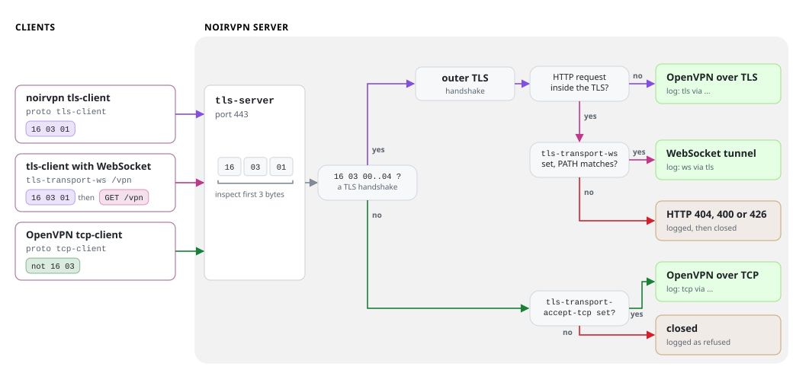
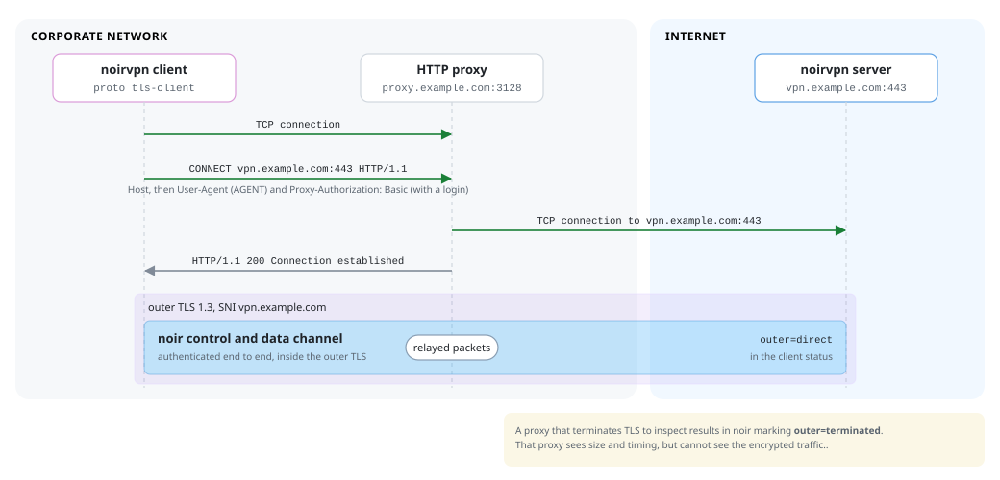
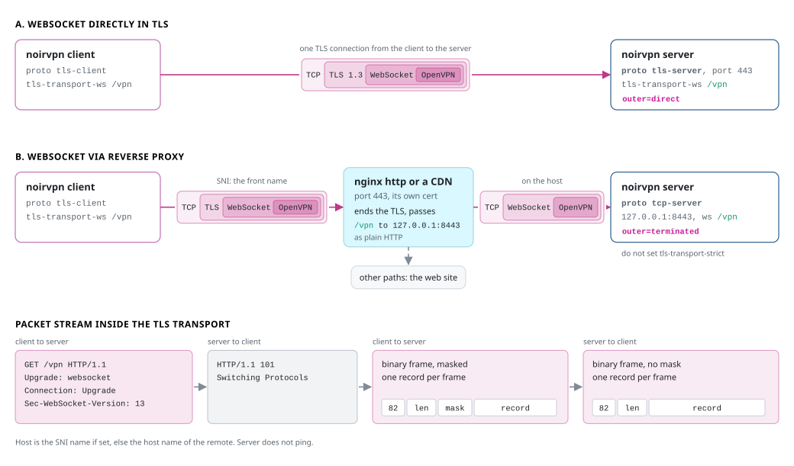

# The TLS transport

The TLS transport sends a noirvpn tunnel inside an ordinary TLS connection on TCP. To a firewall or a proxy, the connection looks like HTTPS. Use it when UDP is blocked and plain TCP is also blocked or recognized, for example on a network that allows only TLS on port 443. If UDP works, use UDP.

This transport is new in noirvpn. Both ends must be noirvpn: a stock OpenVPN client or server cannot use it.

## How it works

A `tls` link has two layers:

1. The outer TLS connection (TLS 1.3, or 1.2). A firewall sees this layer.
2. The normal OpenVPN control channel and data channel inside it. The tunnel is authenticated here, with the same certificates and keys as for UDP.

The client sends no client certificate and does not check the outer certificate against a CA, because the inner session authenticates the server. The key groups of the outer TLS follow `pq-mode` and `tls-groups`.

One TCP connection holds the tunnel, and each packet is encrypted twice. The data path runs in the noirvpn process, not in the kernel or a DCO service.

## Client options

A remote uses the TLS transport when its protocol is `tls-client`, `tls4-client` or `tls6-client`.

| Option | Meaning |
|---|---|
| `remote HOST PORT tls-client` | Uses the TLS transport for this remote. `proto tls-client` sets it as the default. |
| `tls-transport-sni NAME` | Sets the server name (SNI) of the outer TLS. The default is the host name of the remote. An IP address is an error. |
| `tls-transport-strict` | Refuses the connection if the outer TLS does not end at the server. |
| `tls-transport-ws PATH` | Sends the stream in a WebSocket at this path. |
| `tls-transport-hello default\|chrome` | Sets the ClientHello definition of the outer TLS. |
| `http-proxy HOST PORT [AUTHFILE\|auto\|none] [none\|basic]` | Connects through an HTTP CONNECT proxy. |

The `tls-transport-*` options need at least one `tls-client` remote. They apply to every `tls-client` remote and cannot go in a `<connection>` block. `http-proxy` can.

This client tries UDP first and falls back to TLS on port 443:

```
<connection>
remote vpn.example.com 1194 udp
</connection>

<connection>
remote vpn.example.com 443 tls-client
</connection>

tls-transport-hello chrome
```

The log shows `connecting to [198.51.100.7]:443 (tls)`.

## Server options

A server listens for the TLS transport with `proto tls-server`, or with a `local HOST PORT tls-server` line next to other listeners.

| Option | Meaning |
|---|---|
| `proto tls-server` | Listens for the TLS transport. |
| `tls-transport-cert FILE`, `tls-transport-key FILE` | The certificate (leaf first, then the chain) and key of the outer TLS. The default is `cert` and `key`. The key must be ECDSA or RSA. |
| `tls-transport-accept-tcp` | A `tls-server` listener also accepts raw OpenVPN TCP clients on the same port. |
| `tls-transport-ws PATH` | Serves WebSocket clients at this path. |
| `tls-transport-dev NAME` | The second tun device of a [mixed server](server.md#a-mixed-server). |

```
server 10.8.0.0 255.255.255.0
dev tun
cert /etc/noirvpn/vpn-server.crt
key /etc/noirvpn/vpn-server.key
peer-keys /etc/noirvpn/peers
tls-crypt /etc/noirvpn/tls-crypt.key
keepalive 10 60

proto tls-server
port 8443
```

## The strict check

After the inner handshake, the client compares the key of the outer certificate with the key of the server. The `outer=` field of the status line shows the result:

| State | Meaning |
|---|---|
| `pending` | The inner handshake is not finished. |
| `direct` | The outer TLS ends at the server. |
| `terminated` | Something else ended the outer TLS, for example a reverse proxy or a proxy that inspects TLS. The tunnel is still safe, but that party sees the size and timing of the traffic. |

With `terminated`, the client logs a warning and the tunnel goes up. With `tls-transport-sni`, the line is info, because a front name expects a party in front of the server. With `tls-transport-strict`, the client refuses the connection.

- Use `tls-transport-strict` when the path must be direct: an own port, a port redirect, or nginx `stream`.
- Do not use it when a reverse proxy ends the TLS on purpose (nginx `http`, a CDN).

## Sharing a port

A `tls-server` listener looks at the first bytes of each connection:



- TLS: the server runs the outer TLS, then the tunnel or a [WebSocket](#websocket).
- Not TLS: with `tls-transport-accept-tcp`, the server serves a normal OpenVPN `tcp` client. Without it, the server closes the connection.

The server cannot share its port with a web server. For that, put a reverse proxy in front (see [Recipes](#recipes)).

## HTTP proxies

A client behind a corporate proxy reaches the server through an HTTP CONNECT tunnel. Use a `tcp-client` or `tls-client` remote, not `udp`.



```
remote vpn.example.com 443 tls-client
http-proxy proxy.example.com 3128 auto
http-proxy-user-pass /etc/noirvpn/proxy-auth.txt
```

- `auto` tries without a login first and sends Basic after a `407`. `AUTHFILE` and `basic` always send Basic. `none` sends no login.
- Only Basic authentication works. NTLM, Digest and SOCKS are not supported.
- Basic sends the password in clear text to the proxy. Use it only with a proxy that you trust.
- `http-proxy-option VERSION`, `AGENT` and `CUSTOM-HEADER` change the request.

## WebSocket

`tls-transport-ws PATH` wraps the stream in a WebSocket. Use it when a reverse proxy or a CDN passes only WebSocket traffic. Set the same path on the client and the server.



- `PATH` starts with `/`, has at most 255 bytes, and has no space or control character.
- The server serves WebSocket on `tls-server` listeners (the TLS ends at the server) and on `tcp-server` listeners (a reverse proxy ends the TLS and passes plain HTTP).

## The ClientHello profile

`tls-transport-hello chrome` makes the outer ClientHello look like a recent Chrome, so that its fingerprint does not show a VPN. `default` leaves it as the TLS library creates it.

- The AWS-LC build matches the JA4 fingerprint of Chrome 133 and later. The OpenSSL build is close but not equal. At `verb 2`, the client logs which case applies.
- An Ed25519 outer key does not work with `chrome`.
- The profile covers the ClientHello only. It does not hide the size and timing of the traffic.

## Recipes

In each recipe, `vpn.example.com` is the server, and the client has its usual `cert`, `key`, `peer-fingerprint` and `tls-crypt`.

### A. noirvpn on its own port

The server is the config of [Server options](#server-options). The client uses `remote vpn.example.com 8443 tls-client`, and can add `tls-transport-strict`.

### B. Port 443 on the host

When no web server uses port 443, let noirvpn listen on 443, or redirect 443 to it:

```
iptables -t nat -A PREROUTING -p tcp --dport 443 -j REDIRECT --to-ports 8443
```

### C. nginx `stream`: one port for a web site and the VPN

nginx reads the server name in the ClientHello and passes the connection, still encrypted, to the right backend. The TLS ends at noirvpn, so the check is `direct`.

```
stream {
    map $ssl_preread_server_name $backend {
        vpn.example.com  127.0.0.1:8443;
        default          127.0.0.1:8444;
    }

    server {
        listen 443;
        ssl_preread on;
        proxy_pass $backend;
    }
}
```

noirvpn listens with `proto tls-server`, `local 127.0.0.1` and `port 8443`. noirvpn does not read the PROXY protocol, so it sees the address of nginx for every client.

### D. nginx `http`: a WebSocket behind a normal site

nginx ends the TLS, for example with a certificate from a public CA, and passes only `/vpn` to noirvpn.

```
server {
    listen 443 ssl;
    server_name vpn.example.com;
    ssl_certificate     /etc/ssl/vpn.example.com.crt;
    ssl_certificate_key /etc/ssl/vpn.example.com.key;

    location /vpn {
        proxy_pass http://127.0.0.1:8443;
        proxy_http_version 1.1;
        proxy_set_header Upgrade $http_upgrade;
        proxy_set_header Connection "upgrade";
        proxy_read_timeout 1h;
        proxy_buffering off;
    }
}
```

The server has `proto tcp-server`, `local 127.0.0.1`, `port 8443` and `tls-transport-ws /vpn`. The client has `remote vpn.example.com 443 tls-client` and `tls-transport-ws /vpn`, and no `tls-transport-strict`. Set `proxy_read_timeout` longer than the keepalive of the tunnel.

### E. Through a corporate HTTP proxy

Run the server as in recipe A, B or C on a port that the proxy lets through (often 443). Add the lines of [HTTP proxies](#http-proxies) to the client, and `tls-transport-ws` if the proxy allows only WebSocket.

## Limits

- There is no UDP over the TLS transport.
- A stock OpenVPN client can use a `tls-server` port only as a plain TCP client, with `tls-transport-accept-tcp`.
- A `tls` remote runs in the noirvpn process, also with `datapath dco`, `udco` or `auto`.
